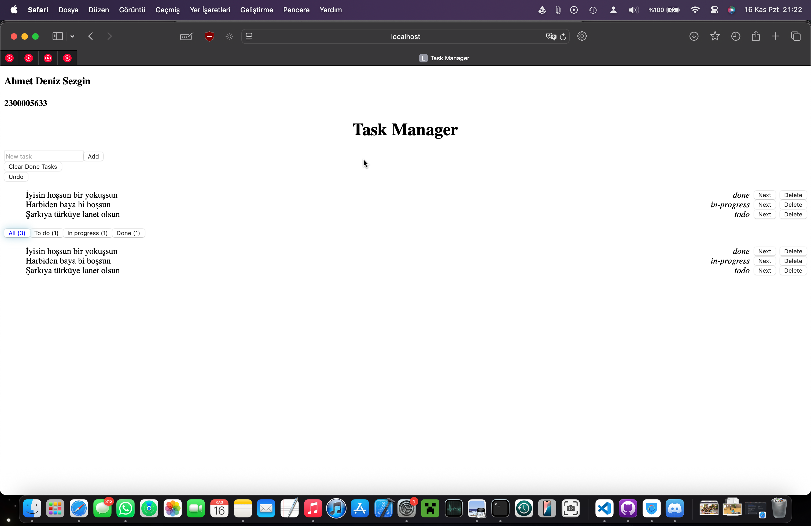
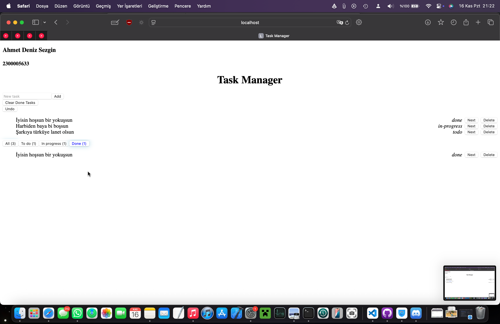

**Full name: Ahmet Deniz Sezgin**

**Student number: 2300005633**

# SEN0415 Assignment 3 — Task Manager with a Reducer

A task manager built with React, TypeScript and Vite.
Application state is managed with useReducer.

## Running the project

The project uses Node.js 24, as specified in `.nvmrc`. From the project folder, run after cloning and changing directory to project root:

```zsh
nvm use
npm install
npm run dev
```

To check TypeScript types and create a production build:

```zsh
npm run build
```

## Features

- Add and delete tasks.
- Cycle task status: todo > in-progress > done > todo.
- Filter tasks by All, To do, In progress and Done.
- Show task counts beside each filter.
- Highlight the selected filter.
- Show a message when the filtered list is empty.
- Clear completed tasks.
- Undo changes to tasks.

The filtered list and counts are calculated during rendering. They are not stored separately in state. Task IDs are generated by the caller, outside the reducer.

## Screenshots

The four views show the same three tasks: one To do, one In progress and one Done.

### All



### To do


### In progress


### Done



## Bonus 1: Undo

State contains `tasks`, `filter` and `past: Task[][]`, which stores previous task lists. The `add`, `advance`, `remove` and `clearDone` actions save the old list, and `undo` restores it while keeping the selected filter. Filter changes are not saved in history, and Undo is disabled when history is empty.

## Bonus 2: Tests

The project uses Vitest with eight tests: `add`, `remove`, `advance`, `setFilter`, `clearDone`, `undo`, `filterTasks` and `countByFilter`. The `add` test also checks that the old state stays unchanged, and the `advance` test checks the full three-step status cycle. The filter test checks all four filters, and the undo test restores tasks after `clearDone`.

Run the tests:

```sh
npm test
```

Actual test output:

```zsh
npm run test

> task-manager-assignment3@0.0.0 test
> vitest run


 RUN  v5.1.0 /Users/deniz/Advanced Web/hw3/starter/Advanced_hw3

 ✓ src/filter.test.ts (2 tests) 2ms
 ✓ src/taskReducer.test.ts (6 tests) 2ms

 Test Files  2 passed (2)
      Tests  8 passed (8)
   Start at  20:48:01
   Duration  88ms (transform 62%, import 21%, tests 9%, worker 8%)

```

## Bonus 3: Explain your reducer

The reducer must be pure: the same state and action should produce the same result without changing the input. My reducer uses a copy of the original variable to work on and returns the copy. Mutating existing state can make React miss an update because the object identity stays the same. It can also corrupt task lists saved for undo.

The caller generates task IDs with `crypto.randomUUID()` before dispatching. The reducer only uses the provided ID and does not create any random or time values. Creating random IDs inside it would make identical inputs produce different outputs and make testing harder.

The visible list and counts are derived from `state.tasks` during rendering. Keeping them separately in state would require updating several values after each action. For example, advancing a task to done could leave an outdated todo count if one update was forgotten.

Putting the filter in reducer state keeps task and filter updates together. Actions such as `clearDone` and `undo` preserve the selected filter, and tests can check this behavior directly. The tradeoff is more action and dispatch code for a simple selection. A separate useState could make filter selection shorter to implement, but would spread the application state across two places.

## Bonus 4: Git repository

[GitHub repository](https://github.com/Ahmetdoesreal/Advanced_hw3)

```zsh
git clone https://github.com/Ahmetdoesreal/Advanced_hw3
```
