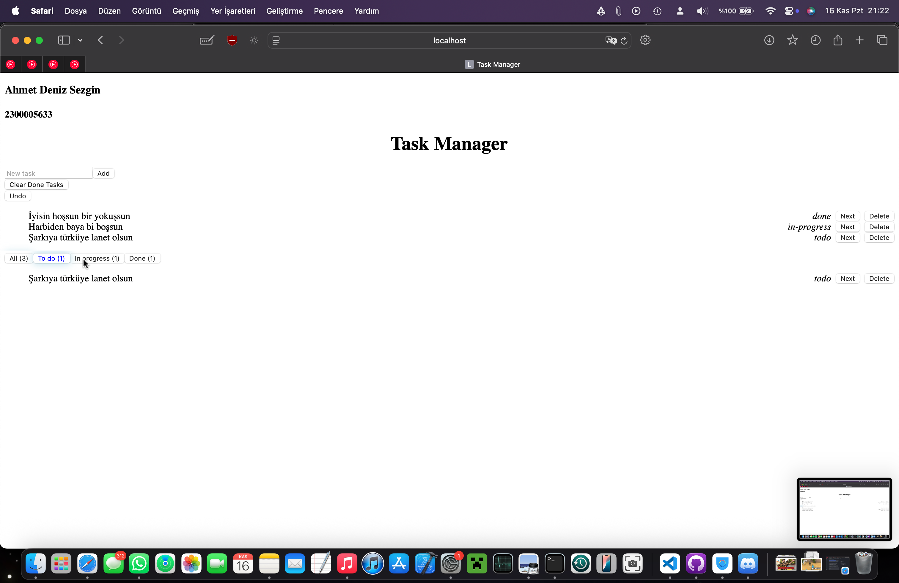

**Full name: Ahmet Deniz Sezgin**

**Student number: 2300005633**

# SEN0415 Assignment 3 — Task Manager with a Reducer

A task manager built with React, TypeScript and Vite.
Application state is managed with useReducer.

## Running the project

The project uses Node.js 24, as specified in `.nvmrc`. From the project folder, run after cloning and changing directory to project root:

```zsh
nvm use
npm install
npm run dev
```

To check TypeScript types and create a production build:

```zsh
npm run build
```

## Features

- Add and delete tasks.
- Cycle task status: todo > in-progress > done > todo.
- Filter tasks by All, To do, In progress and Done.
- Show task counts beside each filter.
- Highlight the selected filter.
- Show a message when the filtered list is empty.
- Clear completed tasks.
- Undo changes to tasks.

The filtered list and counts are calculated during rendering. They are not stored separately in state. Task IDs are generated by the caller, outside the reducer.

## Screenshots

The four views show the same three tasks: one To do, one In progress and one Done.

### All


### To do



### In progress


### Done


## Bonus 1: Undo

State contains `tasks`, `filter` and `past: Task[][]`, which stores previous task lists. The `add`, `advance`, `remove` and `clearDone` actions save the old list, and `undo` restores it while keeping the selected filter. Filter changes are not saved in history, and Undo is disabled when history is empty.

## Bonus 2: Tests

The project uses Vitest with eight tests: `add`, `remove`, `advance`, `setFilter`, `clearDone`, `undo`, `filterTasks` and `countByFilter`. The `add` test also checks that the old state stays unchanged, and the `advance` test checks the full three-step status cycle. The filter test checks all four filters, and the undo test restores tasks after `clearDone`.

Run the tests:

```sh
npm test
```

Actual test output:

```zsh
npm run test

> task-manager-assignment3@0.0.0 test
> vitest run


 RUN  v5.1.0 /Users/deniz/Advanced Web/hw3/starter/Advanced_hw3

 ✓ src/filter.test.ts (2 tests) 2ms
 ✓ src/taskReducer.test.ts (6 tests) 2ms

 Test Files  2 passed (2)
      Tests  8 passed (8)
   Start at  20:48:01
   Duration  88ms (transform 62%, import 21%, tests 9%, worker 8%)

```

## Bonus 3: Explain your reducer

**1. Keeping the old state safe**

The reducer takes the current state and an action, then returns the next state. The same inputs should always give the same result. I use spread syntax, map and filter to create new objects and arrays where needed. Changing the old state directly can make React miss an update. It can also damage the old task lists saved for Undo.

**2. Creating IDs in the form**

The add form creates an ID with `crypto.randomUUID()` and sends it with the title. The reducer just uses that ID. If it created a random ID itself, the same action and state could give different results, making tests harder.

**3. Calculating lists and counts**

All tasks are already in `state.tasks`, so I calculate the visible list and button counts from them during rendering. If I stored the todo count separately, I could forget to update it when a task becomes done. Recalculating the count avoids showing an old number.

**4. Keeping the filter in state**

Keeping the filter with the tasks means I manage both in one reducer. When I clear completed tasks or undo a change, I can keep the selected filter. The cost is writing an action and dispatch for filter selection. A separate `useState` would need less code, but state would then be managed in two places.

## Bonus 4: Git repository

[GitHub repository](https://github.com/Ahmetdoesreal/Advanced_hw3)

```zsh
git clone https://github.com/Ahmetdoesreal/Advanced_hw3
```
